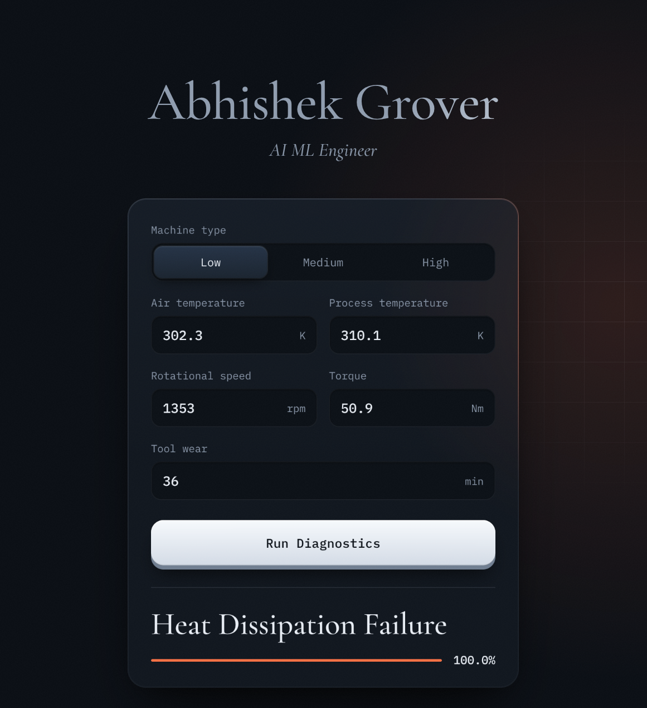

# Predictive Maintenance

Fault diagnosis for industrial machines. An XGBoost classifier takes the machine type and five sensor readings and returns one of six machine states with a confidence score. FastAPI serves the model together with a small web console.



## Run locally

Requires Python 3.12 or 3.13.

```bash
pip install -r requirements.txt
uvicorn app.main:app --reload
```

Open <http://localhost:8000>. Interactive API docs are at `/docs`. Tests: `pip install -r requirements-dev.txt && pytest`

## API

`POST /predict`

```json
{
  "type": "L",
  "air_temperature_k": 302.3,
  "process_temperature_k": 310.1,
  "rotational_speed_rpm": 1353,
  "torque_nm": 50.9,
  "tool_wear_min": 36
}
```

```json
{
  "prediction": "Heat Dissipation Failure",
  "confidence_score": 1.0,
  "all_probabilities": {
    "Heat Dissipation Failure": 1.0,
    "No Failure": 0.0,
    "Power Failure": 0.0,
    "Tool Wear Failure": 0.0,
    "Overstrain Failure": 0.0,
    "Random Failures": 0.0
  }
}
```

`GET /health` reports service status. Optional environment variables: `CORS_ORIGINS`, `LOG_LEVEL`, `MODEL_DIR`.

## Deployment

A `render.yaml` Blueprint is included for Render.

## Model

Multi-class XGBoost classifier trained on SMOTENC-balanced data with a stratified train/test split. The full workflow is in [`notebooks/industrial_iot_fault_predictor.ipynb`](notebooks/industrial_iot_fault_predictor.ipynb).

Data: AI4I 2020 Predictive Maintenance dataset, via Kaggle ([shivamb/machine-predictive-maintenance-classification](https://www.kaggle.com/datasets/shivamb/machine-predictive-maintenance-classification)).

Stack: Python, FastAPI, XGBoost, scikit-learn, pandas, Render.

## Author

Abhishek Grover, AI ML Engineer. [GitHub](https://github.com/AbhishekGrover1) / [LinkedIn](https://www.linkedin.com/in/abhishek-grover-07)

Released under the [MIT License](LICENSE).
